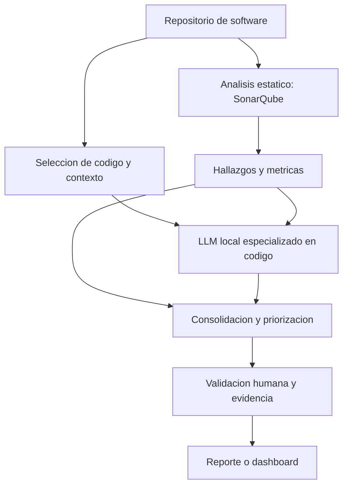

# Aportes de los modelos de lenguaje al análisis estático de código y la gestión de deuda técnica

> **Proyecto de grado:** Prototipo para el análisis predictivo de la deuda técnica a partir de métricas de análisis estático y modelos de lenguaje de código abierto  
> **Actividad:** Investigación sobre aportes de un LLM al análisis de código  
> **Seguimiento:** GitHub Issue #4  
> **Tipo de entregable:** Revisión técnica y fundamentación conceptual  
> **Estado:** Propuesta de investigación; no corresponde a resultados experimentales del prototipo.

## 1. Resumen ejecutivo

El análisis estático permite examinar un programa sin ejecutarlo, mediante técnicas como análisis sintáctico, verificación de tipos, flujo de datos, reglas de calidad y cálculo de métricas. Herramientas como SonarQube identifican hallazgos de mantenibilidad, fiabilidad y seguridad, y estiman el esfuerzo de remediación de determinados problemas [1]. Sin embargo, la interpretación de su importancia para un proyecto concreto puede requerir información adicional: responsabilidades de cada componente, requisitos funcionales, dependencias, cambios históricos y criterios del equipo.

Los modelos de lenguaje de gran tamaño (*large language models*, LLM), incluidos los especializados en código, pueden complementar esa información mediante explicaciones en lenguaje natural, formulación de hipótesis sobre problemas de diseño, agrupación de hallazgos relacionados y sugerencias de refactorización. La literatura sobre LLM aplicados a ingeniería de software documenta múltiples aplicaciones, pero también desafíos de evaluación, fiabilidad y generalización [2]. **Que un modelo produzca una explicación convincente no demuestra que su diagnóstico sea correcto.**

Para el proyecto de grado se propone estudiar una arquitectura híbrida: el analizador estático proporciona evidencias y métricas; un LLM recibe fragmentos de código y contexto seleccionado; y una capa de validación y priorización presenta resultados trazables a desarrolladores. La aportación del LLM debe evaluarse frente a una línea base sin LLM. El análisis contextual y la priorización de hallazgos corresponden al alcance de esta investigación; la **predicción temporal** de la evolución de la deuda técnica exigiría un componente metodológico adicional, con datos históricos, horizonte y variable objetivo definidos.

## 2. Fundamentos conceptuales

### 2.1. Análisis estático y sus capacidades

El análisis estático examina representaciones del software sin ejecutar necesariamente sus instrucciones. Dependiendo del analizador, puede operar sobre el texto fuente, el árbol de sintaxis abstracta (AST), representaciones intermedias, relaciones entre procedimientos o grafos de flujo de control y datos. No es correcto reducirlo a una revisión de estilo: algunos analizadores realizan razonamiento formal sobre propiedades y trayectorias posibles del programa.

SonarQube reúne resultados de analizadores y reglas para ofrecer indicadores de calidad, hallazgos y esfuerzo estimado de corrección. En su documentación, la deuda técnica asociada a mantenibilidad se operacionaliza como el **esfuerzo de remediación estimado** de los hallazgos correspondientes [1]. Esta medida es útil, pero no equivale al costo económico real de mantenimiento ni representa por sí sola toda la deuda arquitectónica, documental u organizacional.

### 2.2. Deuda técnica

La deuda técnica describe compromisos de diseño o implementación que pueden facilitar objetivos inmediatos, pero generar costos o dificultades de evolución posteriores. Puede manifestarse en código, diseño, arquitectura, pruebas o documentación. No todo defecto, complejidad elevada o regla incumplida constituye automáticamente deuda técnica: el diagnóstico depende de las consecuencias de mantenimiento y del contexto del sistema. La revisión de Li, Avgeriou y Liang [3] ofrece una base para entender sus categorías y estrategias de gestión.

Para este estudio se recomienda delimitar primero la **deuda técnica relacionada con mantenibilidad de código y diseño**. Las categorías de seguridad y defectos funcionales pueden analizarse como riesgos asociados, pero no deben sumarse indistintamente a un único índice de deuda.

### 2.3. ¿Qué es un LLM especializado en código?

Un LLM genera respuestas a partir de patrones aprendidos durante su entrenamiento. Los modelos orientados a programación han sido entrenados o adaptados con código, documentación y tareas de ingeniería de software. Pueden describir funciones, comparar implementaciones, proponer pruebas y sugerir modificaciones. No ejecutan ni comprueban automáticamente el comportamiento real del programa por el hecho de analizar su texto.

Conviene distinguir entre **modelos de pesos disponibles**, **modelos de licencia permisiva** y **modelos plenamente abiertos**. Cada versión debe evaluarse según su licencia, documentación, disponibilidad de pesos, condiciones de uso y requisitos técnicos.

## 3. Aportes potenciales de un LLM al análisis estático

### 3.1. Interpretación del contexto del código

El LLM puede complementar un hallazgo con una explicación del propósito aparente de una función, su relación con otros módulos y las consecuencias plausibles de modificarla. Esto resulta especialmente útil cuando el analizador comunica una regla técnica sin describir su repercusión funcional.

**Ejemplo ilustrativo:** un analizador detecta alta complejidad en un método de cálculo de tarifas. El LLM, al recibir el método, sus pruebas y las reglas de negocio documentadas, puede proponer si conviene separar reglas, identificar casos a conservar y explicar posibles riesgos de refactorización. **Sin esos requisitos, no puede verificar que la lógica sea correcta o incorrecta.**

### 3.2. Detección de patrones complejos de diseño

La información contextual puede ayudar al LLM a **señalar candidatos para revisión**, tales como:

- **God Class / baja cohesión:** una clase concentra responsabilidades de distintos módulos.
- **Feature Envy:** un método depende más de los datos o servicios de otra clase que de los propios.
- **Duplicación semántica:** bloques diferentes realizan operaciones equivalentes, aunque no sean textualmente idénticos.
- **Inconsistencia código-documentación:** comentarios, nombres o descripciones parecen contradecir la implementación.
- **Deuda de pruebas:** las pruebas omiten casos relevantes o se acoplan a detalles internos.

Algunos de estos patrones también pueden abordarse mediante analizadores especializados, métricas estructurales y minería de repositorios. El LLM **no posee exclusividad** para detectarlos y sus sospechas deben verificarse con archivos relacionados, relaciones entre módulos, pruebas o revisión experta.

### 3.3. Explicaciones y recomendaciones de refactorización

Un LLM puede transformar resultados técnicos en informes que indiquen: hallazgo, evidencia, posible impacto, alternativas de intervención y pruebas necesarias antes de aceptar una modificación. La salida esperada no debería ser simplemente «reescribir el código», sino una recomendación **trazable** que incluya ruta de archivo, líneas relevantes y supuestos.

La refactorización propuesta puede cambiar involuntariamente el comportamiento, introducir vulnerabilidades o aumentar el acoplamiento. Por ello se recomienda revisión humana y ejecución de pruebas antes de integrar cualquier cambio.

### 3.4. Apoyo a la priorización de deuda técnica

Cuando existen numerosos hallazgos, el LLM puede ayudar a **interpretar prioridades**, pero no debe reemplazar las evidencias cuantitativas ni tomar decisiones de forma autónoma. Los criterios propuestos son:

| Criterio | Fuente preferente | Contribución posible del LLM |
| --- | --- | --- |
| Tipo y severidad de hallazgo | SonarQube | Explicar qué significa la regla en ese contexto |
| Esfuerzo de remediación estimado | SonarQube y revisión técnica | Identificar supuestos y riesgos de la solución |
| Frecuencia de modificaciones | Historial Git | Relacionar los cambios con las responsabilidades del módulo |
| Dependencias y centralidad | Análisis de arquitectura / llamadas | Describir posibles efectos sobre otros componentes |
| Criticidad funcional | Requisitos y responsables del proyecto | Relacionar la evidencia disponible con procesos críticos |
| Prioridad final | Criterios explícitos y validación humana | Justificar la recomendación y señalar incertidumbre |

En la versión inicial de este documento se planteaba una fórmula de **Índice de Prioridad de Deuda (IPD)** con ponderaciones predeterminadas. **No se recomienda adoptar dichos pesos sin un método de calibración y validación**. En esta fase se propone una matriz cualitativa y trazable; una fórmula cuantitativa podría diseñarse después a partir de criterios consensuados y datos del caso de estudio.

## 4. Comparación de enfoques

| Dimensión | Análisis estático | LLM especializado en código | Enfoque híbrido propuesto |
| --- | --- | --- | --- |
| Base del diagnóstico | Reglas, métricas y análisis formal, según herramienta | Inferencia estadística condicionada por el contexto | Hallazgos comprobables enriquecidos con interpretaciones |
| Reproducibilidad | Generalmente alta con misma versión y configuración | Variable según versión, parámetros e infraestructura | Registrar configuración y resultados de ambos |
| Contexto del proyecto | Depende de integraciones, reglas y modelos disponibles | Puede utilizar contexto aportado en la entrada | Recuperar código, dependencias y documentación relevante |
| Explicaciones | Reglas y mensajes predefinidos | Explicaciones adaptadas al caso | Explicaciones con vínculos a evidencia |
| Patrones complejos | Algunos sí, según capacidad del analizador | Puede proponer candidatos adicionales | Contrastar candidatos con análisis y revisión humana |
| Falsos positivos | Posibles, según regla y proyecto | También posibles; puede generar falsos negativos | **Mejora por demostrar**, no garantizada |
| Costos | Infraestructura, configuración y mantenimiento | Memoria, cómputo, energía y tiempo de inferencia | Suma de costos más integración y validación |

La hipótesis principal no es que el LLM sea necesariamente «más preciso»; es que **pueda aportar información útil que no se obtiene del reporte estático aislado**, sin aumentar de manera desproporcionada los errores o el costo de revisión.

## 5. Modelos candidatos y factibilidad de uso local

Existen familias de modelos para programación que justifican una exploración inicial. Los tamaños indicados son variantes publicadas en los trabajos de referencia y **no constituyen una recomendación definitiva de despliegue**.

| Familia | Variantes relevantes | Interés para la investigación | Precaución |
| --- | --- | --- | --- |
| **Qwen2.5-Coder** | 0.5B, 1.5B, 3B, 7B, 14B y 32B [4] | Comparar tamaños y calidad de explicaciones de código | Verificar licencia y recursos de la versión exacta |
| **DeepSeek-Coder** | 1.3B, 6.7B y 33B [5] | Modelo de referencia en tareas de programación | No generalizar resultados de benchmarks a deuda técnica |
| **StarCoder2** | 3B, 7B y 15B [6] | Alternativa de investigación con documentación sobre datos | Revisar condiciones de licencia OpenRAIL |
| **Code Llama** | 7B, 13B, 34B y 70B [7] | Referencia académica y punto comparativo | Revisar la licencia específica de Meta y requisitos |

El uso local puede habilitarse con herramientas de inferencia como **Ollama** o **llama.cpp**, si sus formatos y versiones admiten el modelo elegido. Esto puede evitar el envío del código a una API externa, pero no elimina los riesgos de registros, configuraciones inseguras, dependencias vulnerables o accesos no autorizados.

**Criterios de selección sugeridos:** (1) condiciones de licencia; (2) compatibilidad con el lenguaje de programación del repositorio; (3) calidad en explicación y revisión de código; (4) memoria y latencia medidas en el hardware disponible; (5) facilidad de generar salidas estructuradas; y (6) consistencia en un conjunto de casos repetibles. La decisión final deberá tomarse mediante un piloto, no únicamente por puntuaciones de benchmarks públicos.

## 6. Arquitectura conceptual de integración

**Secuencia propuesta:**

1. Ejecutar el análisis estático sobre un repositorio y conservar su configuración y versión.
2. Extraer hallazgos, rutas, líneas, métricas y esfuerzo estimado cuando esté disponible.
3. Seleccionar, para cada hallazgo, el fragmento afectado y su contexto pertinente (firmas, llamadas, pruebas, requisitos o historial Git).
4. Solicitar al LLM una respuesta estructurada con: interpretación, evidencia, riesgo potencial, nivel de incertidumbre y recomendaciones.
5. Consolidar las respuestas sin convertir suposiciones del modelo en hechos verificados.
6. Aplicar criterios explícitos de priorización y presentar resultados para revisión.
7. Registrar correcciones y decisiones humanas para evaluar el desempeño del enfoque.

**Salida mínima sugerida de cada análisis:** identificador del hallazgo, repositorio/commit, archivo y líneas, regla estática, interpretación del LLM, evidencia citada, incertidumbre, recomendación y estado de validación. El sistema no debería modificar automáticamente el repositorio durante la fase investigativa.

## 7. Límites, riesgos y mitigaciones

| Riesgo o limitación | Efecto sobre el proyecto | Mitigación propuesta |
| --- | --- | --- |
| Alucinaciones | Afirmaciones sobre defectos inexistentes | Exigir referencias al código y comprobarlas |
| Contexto fragmentado | Diagnósticos que ignoran otras clases o requisitos | Recuperación dirigida de dependencias, pruebas y documentación |
| Falsos positivos y negativos | Priorización equivocada u omisión de problemas | Conjunto de referencia y revisión de especialistas |
| Inestabilidad de respuestas | Diferencias entre corridas | Fijar modelo, versión, parámetros, plantilla y contexto; repetir ensayos |
| Sugerencias inseguras | Refactorizaciones que introducen regresiones | Pruebas, análisis estático posterior y aprobación humana |
| Exposición de información | Filtración de secretos o código reservado | Eliminación de secretos, aislamiento, controles de acceso y políticas de registro |
| Licencias y procedencia | Restricciones de uso o redistribución | Auditoría de licencia del modelo y sus dependencias |
| Costo de inferencia | Latencia, consumo de memoria y energía | Preseleccionar hallazgos y medir recursos en el entorno real |
| Sesgos del contexto | El modelo interpreta comentarios erróneos como requisitos | Priorizar evidencia contrastable y registrar supuestos |

Una temperatura baja puede reducir variabilidad de muestreo, pero **no garantiza veracidad**. Del mismo modo, una salida JSON válida garantiza formato, no corrección técnica.

## 8. Propuesta de validación experimental

Esta sección presenta un **diseño futuro**, no resultados obtenidos.

### 8.1. Pregunta de evaluación

¿La incorporación de un LLM de código abierto mejora la utilidad y la calidad de la interpretación y priorización de hallazgos de mantenibilidad frente al uso de SonarQube sin asistencia del LLM?

### 8.2. Diseño comparativo

- **Línea base A:** hallazgos y explicaciones que ofrece SonarQube.
- **Enfoque B:** los mismos hallazgos enriquecidos con explicaciones y propuestas del LLM.
- **Material:** uno o más repositorios con lenguaje y tamaño delimitados; conjunto de casos de referencia revisado por personas con criterio técnico.
- **Control:** mismo commit, mismas reglas y versiones de herramientas, documentación disponible y criterios de evaluación definidos antes de comparar.

### 8.3. Métricas posibles

| Variable | Forma de evaluación | Observación |
| --- | --- | --- |
| Corrección de interpretaciones | Proporción de explicaciones aceptadas por evaluadores | Definir rúbrica y desacuerdos |
| Precisión de hallazgos adicionales | Hallazgos correctos / hallazgos propuestos por LLM | Requiere referencia revisada |
| Recuperación de problemas relevantes | Problemas relevantes identificados / total conocido | Solo calculable si la referencia tiene cobertura suficiente |
| Calidad de la priorización | Acuerdo con orden o categorías de prioridad de evaluadores | Definir criterios de prioridad antes de puntuar |
| Utilidad de recomendaciones | Escala estructurada de relevancia, accionabilidad y riesgo | Revisores idealmente ajenos a la generación |
| Tiempo de revisión | Minutos por hallazgo y por lote | Contabilizar también verificación humana |
| Consumo computacional | RAM/VRAM, tiempo de inferencia y recursos | Medir en hardware especificado |

Es importante **no tomar como indicador de mejora el porcentaje de alertas que el LLM decide descartar**: eliminar muchas alertas no significa que estuvieran equivocadas. Para evaluar falsos positivos es necesario conocer cuáles hallazgos son realmente incorrectos o irrelevantes bajo criterios previamente definidos.

### 8.4. Delimitación frente a la predicción

La detección identifica hallazgos presentes; la priorización ordena acciones; la predicción estima una variable en un horizonte futuro. Si el equipo decide conservar el término **predictivo** como compromiso central del proyecto, necesitará especificar, por ejemplo: deuda de mantenibilidad futura, variación del esfuerzo estimado o aparición de nuevos hallazgos; junto con un horizonte temporal, historial de versiones, variables predictoras, modelo de predicción y evaluación sobre periodos no usados para entrenarlo. **El análisis de una instantánea del repositorio con un LLM no basta para validar capacidad predictiva.**

## 9. Conclusiones

1. El aporte más defendible de un LLM al análisis estático es la **interpretación contextual de hallazgos** y la generación de recomendaciones comprensibles y contrastables.
2. El modelo puede identificar **posibles patrones complejos** de diseño, pero estas observaciones deben considerarse hipótesis que requieren evidencia y validación independiente.
3. Para **priorizar deuda técnica**, resulta más sólido combinar métricas, historial Git, criticidad funcional documentada y validación humana que delegar una puntuación íntegra al LLM.
4. Los modelos que admiten ejecución local ofrecen opciones relevantes de privacidad y control, pero implican costos operativos, restricciones de licencia y riesgos de seguridad que deben revisarse caso por caso.
5. El valor real del sistema híbrido sigue siendo una **hipótesis de investigación**. Se propone medirlo mediante comparación reproducible con una línea base estática, casos de referencia y evaluación humana.
6. La predicción de deuda técnica debe tratarse como un **objetivo metodológico separado** mientras no se definan datos históricos, variable futura y validación temporal.

### Resultado del sprint

Este documento satisface la fase de **investigación y fundamentación** del Issue #4: describe aportes potenciales, límites, riesgos y una integración conceptual. No implica que se haya elegido un modelo definitivo, construido el prototipo ni validado experimentalmente los beneficios descritos.

## 10. Referencias

> Se mantienen fuentes científicas y documentación técnica identificables. Los enlaces permiten su comprobación; la evaluación experimental propuesta en este documento es elaboración propia.

[1] SonarSource. (s. f.). *Understanding measures and metrics*. SonarQube Server Documentation. https://docs.sonarsource.com/sonarqube-server/user-guide/code-metrics/metrics-definition

[2] Hou, X., Zhao, Y., Liu, Y., Yang, Z., Wang, K., Li, L., Luo, X., Lo, D., Grundy, J., & Wang, H. (2024). Large language models for software engineering: A systematic literature review. *ACM Transactions on Software Engineering and Methodology, 33*(8), Article 220. https://doi.org/10.1145/3695988

[3] Li, Z., Avgeriou, P., & Liang, P. (2015). A systematic mapping study on technical debt and its management. *Journal of Systems and Software, 101*, 193–220. https://doi.org/10.1016/j.jss.2014.12.027

[4] Hui, B., et al. (2024). *Qwen2.5-Coder technical report* [Prepublicación]. arXiv. https://arxiv.org/abs/2409.12186

[5] Guo, D., et al. (2024). *DeepSeek-Coder: When the large language model meets programming—The rise of code intelligence* [Prepublicación]. arXiv. https://arxiv.org/abs/2401.14196

[6] Lozhkov, A., et al. (2024). *StarCoder 2 and The Stack v2: The next generation* [Prepublicación]. arXiv. https://arxiv.org/abs/2402.19173

[7] Rozière, B., et al. (2023). *Code Llama: Open foundation models for code* [Prepublicación]. arXiv. https://arxiv.org/abs/2308.12950
